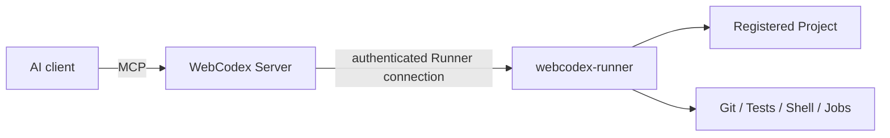
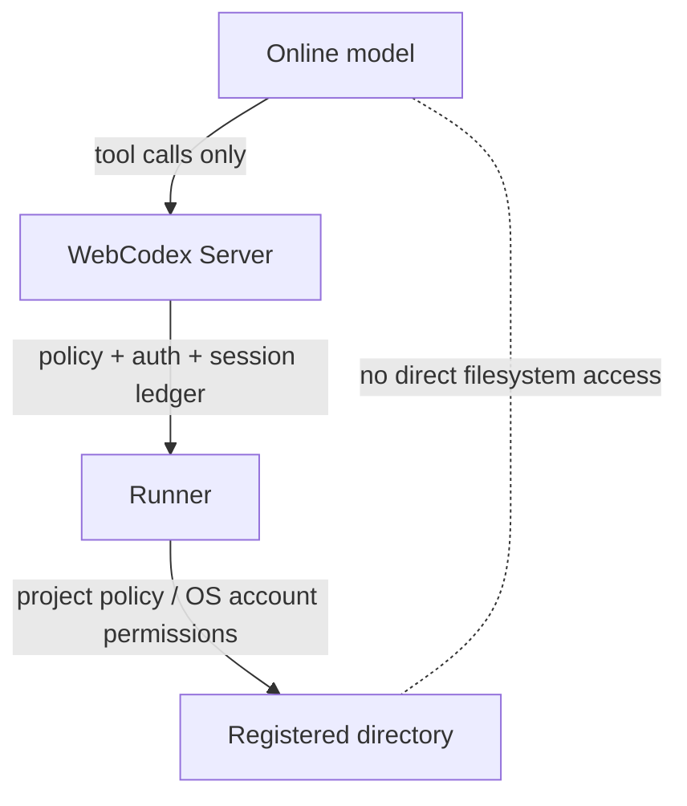

# Architecture

WebCodex is a self-hosted tool runtime that lets online AI clients work with
registered directories, files, and code through a Server and a local Runner.
The Server can also retain
durable Agent/Conversation state independently of a browser window. This page is the
current source architecture and reading entry point; the [CLI](CLI.md), [Runner](RUNNER.md), [Deployment](DEPLOYMENT.md),
and [Authentication](AUTH_MODEL.md) guides cover the operational details.

For a short definition of the terms, see the terminology sections in
[CLI](CLI.md#terminology) and [Runner](RUNNER.md#core-terms).

Read the [architecture path](INDEX.md#architecture-reading-path) before selecting
individual contracts. Historical experiment counts and proposed directions are
identified separately; source behavior on `main` is not a promise that every
published release or Host exposes the same capability.

## Client → Server → Runner → project



The online client calls WebCodex over MCP. The Server
authenticates the caller, applies policy, and routes runtime tool calls to a
connected Runner. The Runner owns the local project boundary and performs the
file, Git, validation, shell, and Job work on the machine that has the code.

The Server does not discover or read Runner project files through its own filesystem.
It requests authorized operations from the Runner and returns their results to the
client; requested file contents and command output can therefore reach the model.
Projects are registered by Runners; the Server addresses them by runtime
project id `agent:<client_id>:<project_id>`.

## Product surfaces

WebCodex exposes the same Server/Runner runtime through several user-facing adapters:

- **MCP** — the recommended model-facing integration for ChatGPT, Claude, and other MCP clients.
- **REST** — the Server HTTP runtime API.
- **CLI** — operator/developer setup, lifecycle, and diagnostics.
- **Desktop** — native setup and management UI over the same Environment and runtime; it is not a second execution backend.
- **Console** — the Server-hosted operator browser surface.

A regular Server + Runner and the local `webcodex share` / `webcodex run` lifecycle all expose the ordinary WebCodex runtime. `share` and `run` are deployment/auth/reachability conveniences around one locally registered Project; they do not define a second coding runtime or task model. Their project-scoped credentials restrict which Runner/Project is visible without changing ToolRuntime semantics.

Internal type names used to route these adapters are maintainer implementation details; ordinary users should follow the tools and connection instructions returned by the current Server.

### Console inventory, refresh and credential ownership

The browser Console deliberately separates cheap navigation state from detailed evidence:

- The primary Overview is a bounded Runner-registry snapshot plus active-job and active-Window summaries. It does not scan Project Session history or return full Project rows. Project inventories and Session history are loaded through their own bounded endpoints when the relevant surface needs them.
- The primary Overview's independent registry, active-job and active-Window reads run concurrently. Full Runner/Session detail remains an explicit, more expensive hydration path.
- Visible navigation refreshes the primary Overview every 5 seconds; full Session overview hydration refreshes every 20 seconds. Project inventories refresh every 10 seconds by default (the Work catalog uses 15 seconds). Window liveness remains a separate 3-second observation from historical inventory/detail reads. Hidden pages pause periodic refresh and coalesce focus/visibility recovery.
- Every read is owned by the current client authority generation. A response initiated under an earlier credential may neither populate the new workspace nor interpret its 401 as evidence that the current credential is invalid. Deterministic 403/404 visibility results remain distinct from transient transport/server failures.
- Session record navigation retains a direct return to the Window workbench; Session evidence and Window activity remain separate views rather than silently substituting one for the other.

These are Console client/server behavior contracts, not a claim that Runner transport uses browser WebSockets. Runner connectivity and registration remain Server-owned; the browser observes bounded Server projections over the runtime HTTP API.

## Project registration

Projects live on the Runner machine. The Runner registers allowed directories
with the Server; the Server does not discover project paths on its own. A
runtime project id addresses one registered project:

```text
agent:<client_id>:<project_id>
```

`client_id` is the stable logical identifier of a Runner/device; `project_id`
is the id registered by that Runner in its `project-registry` registry.
`allowed_roots` controls where projects may be registered or created (default
`$HOME`; an explicit list narrows it).

For the regular coding runtime, `work_on_project` can optionally collapse a
source-checkout bootstrap into the same authority path. The canonical model form
is `project + mode=worktree`: the Server reauthorizes that registered source
Project and passes its exact Runner/root identity as a fence. `client_id + path`
remains a compatibility/bootstrap form. The Runner resolves the requested Git
base to an exact commit, chooses a Runner-owned managed-worktree location inside
its current filesystem policy, creates a detached worktree, and registers it in
the same Project Registry before the Workflow Session starts. The resulting
workspace is therefore a normal registered runtime Project: subsequent
read/edit/Git/validation tools use the same `allowed_roots` boundary and gain no
path-based bypass. The model never chooses the managed host path, the Server does
not interpret the Git ref, and Session finish does not implicitly delete the
worktree or its registration.

## Durable Agent and asynchronous work

The Server also owns a durable Agent/Conversation domain for communication and asynchronous work. A Durable Agent is separate from a Runner/device, browser window, credential, Project, and Workflow Session.

This separation matters because the historical `agent:` prefix still appears in some Runner/runtime compatibility identifiers. That prefix does not turn a Runner or runtime Project into a Durable Agent.

Conversation membership and Durable Agent identity grant only the communication/workflow authority defined by that domain; they do not grant repository, Runner, filesystem, Job, or Workflow Session access.

Maintainer-level lifecycle and Agent Task/TaskAttempt details live in [Durable Agent runtime and asynchronous work](architecture/durable-agent-runtime.md) and [Durable Agent/Conversation/Wake contract](architecture/durable-agent-conversation.md).

The Server also owns an independent durable **Goal** domain for high-level intent/control state. A Goal answers what the user ultimately wants and the authoritative high-level lifecycle of that intent. It is not a Workflow Session, Agent Task, Job, Project selector, credential, or execution authority. Goal references to Agent Tasks and Workflow Sessions are explicit correlation only; dereferencing those ids always re-runs the referenced domain's normal authorization.

Stateless MCP 2026 can optionally present one exact Goal through the sparse Goal Plan App. `present_goal_plan(goal_id)` is the sole model-visible App-bound entry; the View converges through the ModelHidden/app-only `sync_goal_plan(goal_id)` read. Both are bounded observations over the same SQLite Goal truth and carry no Project, Runner, Job, Workflow Session mutation, or Host-continuation authority. Existing coding tools do not require Goal identity and keep their normal/native presentation.

## Goal, Job, and Workflow Session continuity

- **Goal** — high-level durable intent/control state (`wc_goal_*`). It can correlate multiple work/execution records, but it does not run them and is never inferred from the current Project, window, credential, or Workflow Session.
- **Job** — a long-running command or validation that continues after the initiating call returns. Observe the same Job instead of starting another copy.
- **Workflow Session** — bounded coding evidence/continuity used by the runtime for review, validation, collaboration, and closeout. It is not a credential.

These objects have different lifecycles and are never inferred from one another merely because requests share a user, credential, project, or chat window. Coding work does not create a parallel Connector Task/Run/Result lifecycle.

## Runner execution boundary

The Runner is the trust boundary closest to the repository:

- Project resolution and structured file operations enforce registered roots and
  the configured `allowed_roots` policy. Process tools run with the Runner OS
  account's permissions; project roots are not an operating-system sandbox.
- Shell and Job tools are bounded execution primitives, not replacements for
  structured tools. Prefer structured read, edit, validation, and native argv
  operations when they fit; use `run_shell` for real shell semantics or short,
  tightly related command chains.
- Shell profiles prepare a one-time environment snapshot per project/profile;
  `~/.bashrc` / `~/.profile` are not sourced by default.
- The Runner connects out to the Server over QUIC, WebSocket, or polling, and
  reconnects automatically. A disconnect is a liveness fact, not a lost-work
  fact. For a Runner advertising Job reconciliation, active Jobs enter bounded
  `recovering` state and can reconcile from the same instance's inventory. Without
  that capability, or when the recovery deadline expires or the instance is
  replaced, ordinary Jobs become `lost`. Reconnection never authorizes replay.

Runner Job wire lifecycle vocabulary is interpreted once by the canonical typed contract in `webcodex-core`; the Runner, Registry, Store, and Workflow Session then project that lifecycle into their own domain states. Server
recovery remains an orthogonal Registry overlay, so `recovering` is an observed
recovery state rather than a Runner wire lifecycle value.

## Security boundary



The model sees tool results, not arbitrary local files. Access is bounded by:

- bearer authentication mapping to a principal,
- scoped user tokens for the client surfaces,
- Runner tokens bound to a `client_id` for transport,
- `allowed_roots` and path policy on the Runner,
- an authority mode that auto-authorizes consequential tools after hard safety
  checks (`trusted_agent`) or denies them (`restricted`); restricted mode does
  not create an approval queue,
- bounded, redacted session evidence.

See [SECURITY.md](../SECURITY.md) and [AUTH_MODEL.md](AUTH_MODEL.md).

## Persistence and recovery

The Server persists managed accounts, OAuth state, Workflow Session evidence, durable Agent/Conversation/Agent Task state, and durable Goal state. Workflow Session, Agent Task, and Goal continuity is restored from each domain's own durable identifiers; WebCodex does not invent continuity from a credential, current browser window, Project, or neighboring domain identity.

Runner Jobs are reconciled when the same live Runner process reconnects. Ordinary child processes cannot be adopted by an unrelated replacement Runner; specialized detached execution has its own explicit durable ownership path. The stable Runner `client_id` and the current process lease are separate, but the exact lease field is an internal wire detail.

Durable Store aggregates use closed typed Rust lifecycle/state contracts for business authority. SQLite `TEXT` values and `CHECK` constraints remain the persistence encoding, not a second semantic registry. Durable Agent/Conversation/Agent Task/Goal state and other current Store domains decode fail-closed from their owned vocabularies; ordinary coding uses Workflow Session and Runner Job state instead of a parallel Task/Run/Result/Approval schema.

## Module map and one request

Start at the owning layer, then follow its caller and tests. The [documentation
index](INDEX.md#architecture-reading-path) routes the deeper contracts; this page
does not define a second schema or lifecycle.

| Owner | Responsibility and boundary | Source entry |
| --- | --- | --- |
| Protocol adapters | Authenticate the caller, establish only supported Host/transport context, and enter the shared runtime. Desktop and Console remain adapters. | [MCP](../src/mcp.rs), [HTTP](../src/runtime_http.rs), [route metadata](../src/route_metadata.rs) |
| Tool contracts | Declare visibility, capabilities, scopes, audit/evidence policy and typed request schemas. Discovery never creates authority. | [ToolDefinition](../crates/webcodex-tool-contracts/src/tool_definition.rs), [request schemas](../crates/webcodex-tool-contracts/src/request_schema.rs) |
| Runtime kernel and domains | Preserve caller/recorder identity, admit requests, resolve authorized targets and route to domain owners. | [Kernel](../src/tool_runtime/kernel.rs), [governance](../src/tool_runtime/dispatch/governance.rs), [domain convergence](architecture/tool-runtime-domains.md) |
| Runner and Registry | Execute on the selected device; fence replacement instances, own process trees, reconcile the same Job. | [Runner source](../crates/webcodex-runner/src/webcodex_runner), [Registry reconciliation](../crates/webcodex-runner-registry/src/reconciliation.rs) |
| Workflow Session and Store | Persist bounded evidence and domain-owned lifecycle facts; presentation does not create execution truth. | [Session residency](../crates/webcodex-workflow-session/src/store/residency.rs), [Store](../crates/webcodex-store/src) |
| Result adapters | Capture canonical evidence first, then project bounded model/UI results with independent privacy and retention rules. | [Post-record response](../src/tool_runtime/kernel/postprocess.rs), [result projection](../src/tool_runtime/result_projection.rs) |

For an ordinary project tool such as `read_files` or `run_process`, the request
passes through these boundaries:

1. The MCP/HTTP adapter supplies authentication and protocol capabilities.
   `ToolCallContext` carries trusted transport, supported `ClientWindow` and
   optional outer recorder identity; none is inferred from the Project.
2. The kernel admits the invocation and parses the canonical typed `ToolCall`.
   The explicit business `session_id` stays on that call. An outer recorder may
   record a worker reading another Session without becoming that target Session.
3. `DispatchContext` carries those facts into `govern_dispatch`, preserving the
   established ordering of target resolution, Session/scope/Runner guards and
   the single ordinary permission decision. Routing receives a private
   `AuthorizedDispatch`, not independently assembled authority parameters.
4. The selected domain still enforces its own paths, capabilities and effect
   fences. Runner work goes to the resolved device/root/instance. A long-running
   operation may return the same execution as a Job; it does not launch again
   because the Host call ended.
5. Control-sidecar outcomes and Session/permission evidence are recorded before
   `kernel::postprocess` captures canonical audit output and consumes the one-shot
   model projection. Bounded response-only attention cannot redispatch the main
   operation or rewrite its execution truth.

[Kernel pipeline tests](../src/tool_runtime/tests/kernel_pipeline.rs) and
[dispatch tests](../src/tool_runtime/tests/dispatch.rs) are starting points for
reproducing these invariants. Their presence is not a claim that a particular
Host or deployed build was tested.

### Why one generic dispatcher is insufficient

Action-dependent Plugin and SSH gateways enter
[`try_dispatch_specialized_gateway`](../src/tool_runtime/specialized.rs) before
the generic static Session/permission lifecycle. The closed boundary uses the
same typed parser, but the gateway owns its exact action policy, process/protocol
lifecycle and uncertain-result handling. Shared specialized governance and finish
helpers run once; discovery metadata keeps the worst-case policy.

This avoids classifying a heterogeneous gateway's read and effectful actions by
one static permission decision. It does not bypass canonical authorization or
create a second set of ordinary tools. See
[specialized-dispatch tests](../src/tool_runtime/tests/specialized_dispatch.rs)
and the [Plugin contract](architecture/native-tool-plugins.md).

### Typed facts, bounded reads and presentation

[Job queries](../src/tool_runtime/job_query.rs) select authorized Registry records
and apply filters/order/limits before projection. The internal
`JobInventoryPage` is deliberately not serializable: `list_jobs` and
[Console Job projection](../src/runtime_console_http/job_projection.rs) consume
the same typed facts, while passive Work Result/attention snapshots retain their
separate non-refreshing read path. See [query tests](../src/tool_runtime/tests/job_query.rs).

Presentation snapshots are owned by a `ToolRuntime`, shared by its clones and
isolated from independent runtimes. Review, Changes and workspace observations
retain distinct authority fences, quotas and lifetimes. File-read revisions are
a different correctness boundary: cached range bytes still require fresh Runner
SHA evidence and edits recheck the original target and source. Their current
design and tests live in [ToolRuntime domains](architecture/tool-runtime-domains.md)
and [file-read snapshot ownership](implementation/read-snapshot-service.md).

Validation consumes its typed evidence rather than reparsing model JSON. Historical
validator success does not prove current source stability; an unproven current
source must not be projected as `passed`. See
[typed closeout facts](implementation/typed-closeout-facts.md) and
[validation evidence](implementation/validation-success-evidence.md).

Frontend read cancellation/coalescing cannot cancel mutations, replace delivery
keys or renew Agent Endpoints. These are separate lifecycles, explained in
[Window polling consistency](implementation/window-polling-consistency.md) and
[Work Result read lifetimes](architecture/work-result-read-lifetimes.md).

### Tool contracts, audit and Session evidence

The [tool-contract guidelines](agent/tool-contract-guidelines.md) own model-facing
ergonomics: strict identity, authority, retry/effect truth and privacy; harmless
bounded presentation normalization; one domain-proven parser-ready next action.
Internal taxonomy and diagnostics are disclosed only when they change interpretation
or the next safe action. Continuation, failure recovery and message ACK remain
separate semantic lanes.

`ToolDefinition` also owns the static audit and Workflow Session evidence policies.
Typed `ToolCall` request projection is the sanitizer; unknown/unprojectable requests
fall back to an empty audit object, never raw business arguments. Result fields,
persisted context and execution excerpts are bounded by the same declared policy.
Session's final persistence fence preserves that policy without making a duplicate
field registry. The [definition regression](../crates/webcodex-tool-contracts/src/tests/definitions.rs)
`every_runtime_tool_has_an_explicit_fail_closed_audit_contract` checks admission
of those declarations.

Audit is observational: its projection never supplies execution arguments, OAuth
scopes, permission decisions, Runner identity or retry authority. Static Session
policy declares evidence meaning; typed bounded Session projectors still decode
results and enforce privacy. Validation identity normalization/hashing stays in
`webcodex-core`, not in a second schema or serialized-result registry. See the
[Session model](agent/session-model.md) and [tracing contract](agent/tool-request-tracing.md).

### Optional workspace snapshots

Git/worktree `workspace_checkpoint_*` tools require the `workspace-checkpoints`
feature on Server and Runner. Default builds omit their implementation, tools,
schemas and handoff projection; dormant Runner operations fail closed.
`include_checkpoints` remains accepted and is ignored when disabled. This feature
does not disable ordinary Session handoff, ACK/message observation, validation
evidence or Jobs. The shared workspace path policy remains active for
`read_project_overview`.

### Cargo workspace ownership layers

The checked-in [`workspace-boundaries.toml`](../workspace-boundaries.toml) is the
machine policy for direct dependencies between Cargo workspace packages. It
records every workspace package, its ownership role, and its exact normal,
development, and build-time workspace dependencies. Production dependencies
may stay within a layer or point toward a lower layer; explicit development
dependencies are test-only exceptions. Uses of the `root-test-support` feature
are separately pinned to declared development dependencies.

The current layers are:

- **leaf** — low-level contracts/primitives in `webcodex-core`,
  `webcodex-process`, `webcodex-computer`, and `webcodex-admin`; computer primitives
  consume core contracts, while core/process/admin have no workspace dependencies.
- **domain** — Runner config/registry, Store, Workspace, Workflow Session,
  Tool contracts, Validation, Persistent Shell, and native LSP ownership.
- **runtime** — `webcodex-runner`, `webcodex-tool-runtime-contracts`, environment
  lifecycle, and the composition-only `webcodex-build-info` provider.
- **composition** — the root `webcodex` package, which owns Server composition
  and protocol adapters rather than forcing those concerns into lower crates.
- **entrypoint** — `webcodex-cli`, the user-facing executable over the lower
  composition and setup crates.

CI validates this policy from `cargo metadata`; adding a workspace crate or a
new direct workspace dependency therefore requires an intentional policy
update rather than silently changing the architecture.

### Build identity does not own core invalidation

`webcodex-core::build_info` contains only stable metadata types and formatting.
The small `webcodex-build-info` package owns the Git/dirty build script and its
compile-time capture. Server, Runner, CLI and the separate Desktop workspace use
that provider directly; domain crates never depend on it. There is no runtime
Git lookup, mutable global identity, copied collector, or new external dependency.
Identity-only changes therefore invalidate composition rather than core's domain
consumers. Release overrides, linked-worktree handling and dirty-state truth stay
in the existing collector. See [the experiment and regression contract](implementation/build-identity-isolation.md).

## Further reading

The [documentation index](INDEX.md#architecture-reading-path) gives the ordered
reading path. For design study, follow each current contract to its source and
negative/recovery tests before treating a diagram or benchmark as a guarantee:

- [Durable Agent runtime](architecture/durable-agent-runtime.md) and
  [Conversation/Wake contract](architecture/durable-agent-conversation.md) separate
  Goal, Agent Task/TaskAttempt, communication, Workflow Session and execution.
- [Browser/CDP](architecture/browser-cdp-runtime.md) and [Computer Use](COMPUTER_USE.md)
  explain target identity, stale snapshots, human handoff and platform boundaries.
- [Resource model review](architecture/resource-model-and-quality-review.md) separates
  the existing Memory/Skill/Plugin owners from research directions. Memory and tool
  discovery are not a built-in vector RAG pipeline.
- [Code Mode experiment](experiments/code-mode.md) separates Host orchestration
  from WebCodex's feature-gated V8 experiment. Its measured conditions and the
  [composition research record](architecture/tool-composition-research.md) do not
  promise automatic Host continuation or production adoption.
- [Authentication](AUTH_MODEL.md), [SECURITY.md](../SECURITY.md),
  [Runner](RUNNER.md) and [Deployment](DEPLOYMENT.md) own operational boundaries.
