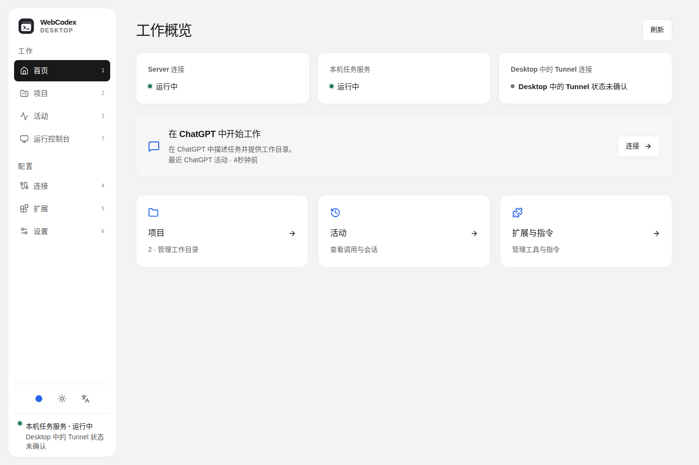
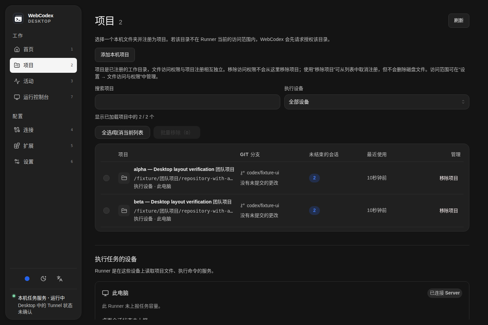
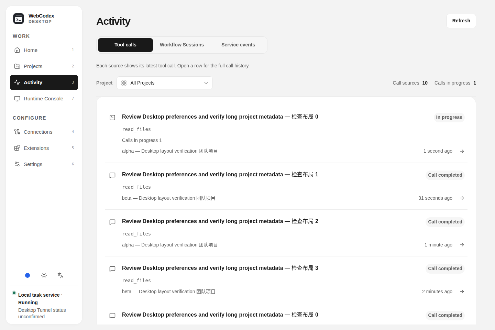
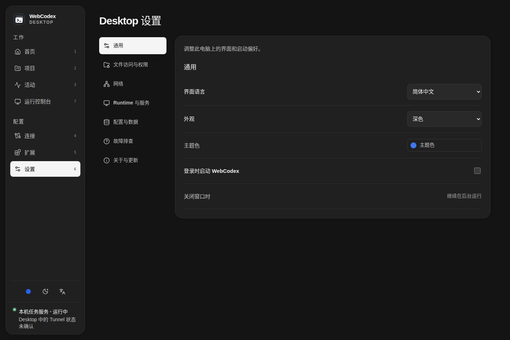
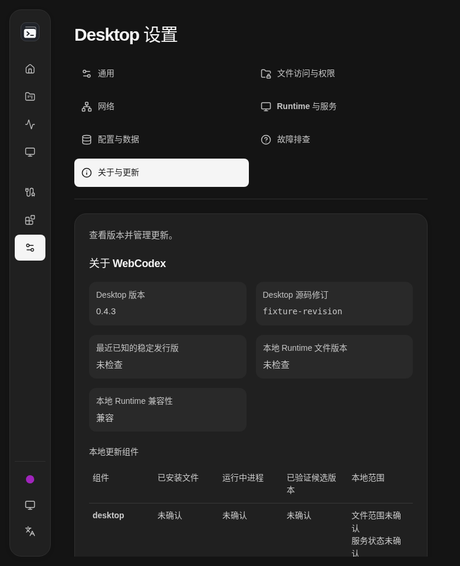
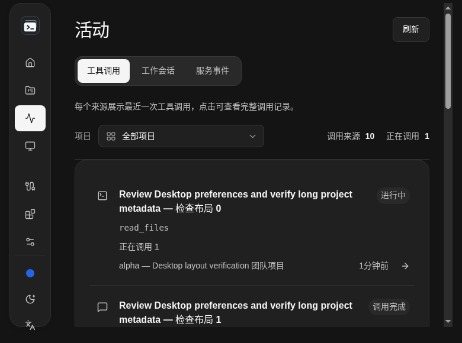
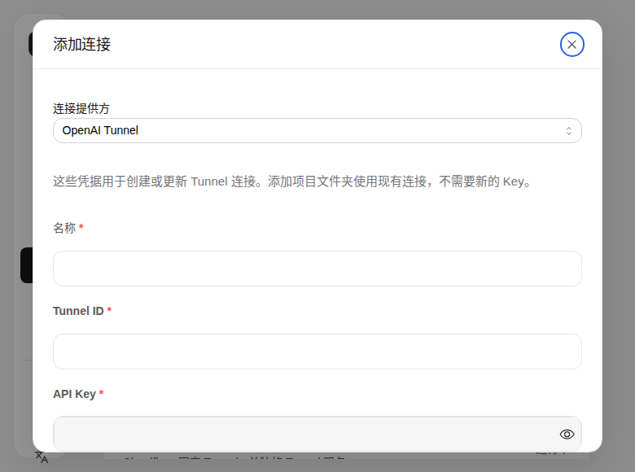
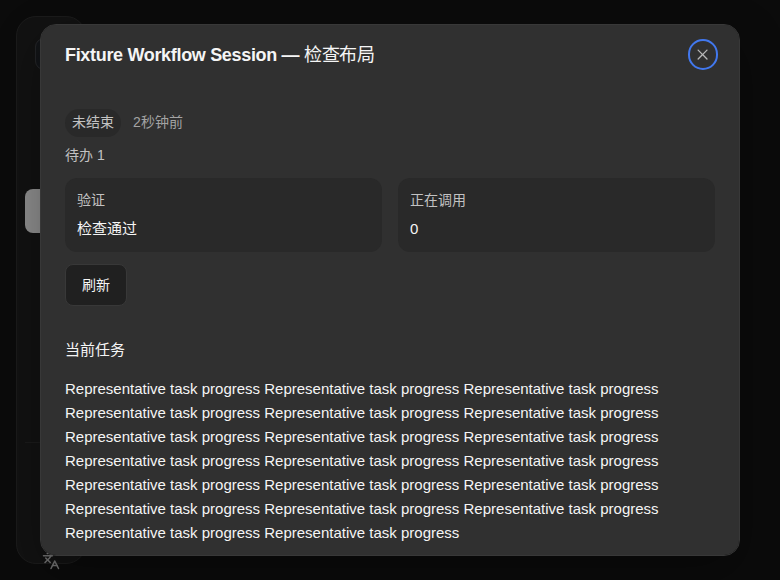

# Desktop solid-surface design

Desktop follows the approved Web visual direction from [PR #1173](https://github.com/yyjeqhc/webcodex/pull/1173), with a separate platform-neutral implementation tracked in [Issue #1174](https://github.com/yyjeqhc/webcodex/issues/1174). This branch does not depend on the pending Web branch. Desktop owns native lifecycle, connections, permissions and local configuration; their behavior is preserved.

## Layout contract

- Neutral light/dark canvas, opaque rounded content regions, weak separators and restrained shadows. The Desktop root explicitly opts into `styles/theme.css`; other renderers keep their own styling.
- A 224px navigation region becomes a 70px compact rail at 1100px. The native minimum window width remains 780px. Supplemental narrower fixture checks exercise clipping and translation behavior.
- All destinations share a 1440px maximum reading measure, 24px page/panel insets and section gaps (16/20px in supplemental narrow layouts). The main scroller reserves its scrollbar gutter to keep page headings stable.
- Selected primary/category navigation and activity tabs use black/white, inverted in dark mode. Entity selection retains a subtle full outline and restrained accent surface. No decorative selection rails remain.
- Three 36px Mantine controls provide preset/custom accent, System/Light/Dark cycling and a seven-language radio menu. The same source-owned accent/appearance component is used by the pending Web implementation. Popups use solid theme surfaces and library-owned focus/dismissal.
- One type scale applies across pages: 22px page titles, 18px panel titles, 16px sections, 14px body, 13px secondary text and 12px captions. Headings and emphasized values use weight 600; controls, labels and navigation use 500 so CJK system fonts do not fall back to bold. Native and Mantine buttons, inputs and selects share the foundation's 40px control height, and native selects, checkboxes and the launch-at-login switch use Desktop styling instead of per-OS defaults.
- Long values wrap within their label/value regions. Tables scroll inside their bounded containers; dialogs remain reachable in short windows. Native-control styling excludes Mantine composite inputs.

## Reproducing UI evidence

Run the [Desktop frontend checks](../../DESKTOP_DEVELOPMENT.md#fast-checks-before-opening-the-app), then:

```sh
node scripts/ui-smoke/desktop-soft-surfaces.mjs
```

The harness uses production Desktop assets and isolated loopback fixtures. It exercises all seven destinations, Activity tabs/details, Settings/Extensions categories, connection/plugin dialogs, long identities, preferences, keyboard focus, light/dark themes and English/Chinese at 1440/1280/1024/780/768/390px. Native Desktop has a 780px minimum; narrower browser fixtures are supplemental, not a claim of native mobile support. Reports and full screenshots are regenerated under ignored `artifacts/desktop-soft-surfaces/`.

Curated screenshots below contain synthetic fixture data only. Native Linux window verification and authenticated reads are recorded separately in the PR. Windows/macOS native execution, installers, reboot, real-model and destructive live workflows are outside this task's acceptance.

The older `desktop-workflow-layout.mjs` currently stops when it tries to edit
`#desktop-trace-mode`: its fixture lacks trace-edit authority and the control is
correctly disabled. The same failure was directly reproduced using a separately
built unmodified upstream/main checkout. This run is not passing evidence; the
focused matrix keeps authority intact and tests the current reachable controls.

## Fixture gallery













## Mounted resize and theme audit

Fresh fixed-size screenshots are supplemented by two repeatable mounted-flow checks:

```sh
node scripts/ui-smoke/desktop-resize-theme.mjs
node scripts/ui-smoke/desktop-dialogs.mjs
```

The audited run passed 54 localized page states / 11,850 assertions / 324
screenshots and 68 localized dialog cases / 3,136 assertions / 602 screenshots,
with zero failures or renderer errors. Desktop typechecking, all 740 tests and
the production build passed. Both harnesses use the production frontend and
isolated native-command fixtures. The page
matrix keeps each view mounted through 1440×960, 1280×760, 1024×580, 780×580,
1180×760 and back to 1440×960. It flips light/dark and follows OS scheme changes,
checking heading/content origins, selected navigation and tabs, input drafts,
horizontal overflow and access to sidebar preferences. The inline update
confirmation additionally checks its geometry and action reachability.

| Inventory | Mounted coverage in English and Chinese |
| --- | --- |
| Main destinations | Home, Projects, all three Activity tabs, Connection, Console |
| Extensions | Coding agents, SSH resources, MCP servers, native plugins, skills, instructions |
| Settings | General, access, network, runtime, configuration, diagnostics, about |
| Setup and banners | First run, create/join/quick-share setup, setup completion, running operation, update confirmation |
| Project dialogs | Add local folder/device, single and batch unregister |
| Connections | Generic create/edit/delete; named and quick Cloudflare creation, existing owner edit, OAuth confirmation |
| Extensions dialogs | Coding Agent create/edit/remove/authorize, SSH create/remove/authorize, MCP create/edit/delete, plugin registration, project/Runner instruction previews |
| Runtime and diagnostics dialogs | Runtime restart warning, Runner capacity restart, full trace, save/restart, configuration recovery, sensitive clipboard confirmation |
| Work and permissions dialogs | Window detail, Session detail, Window→Session replacement, HTML computer permissions welcome |

The dialog matrix covers 34 variants in both languages. Each remains open through
1440×960 → 1024×760 → 780×580 → 1440×960 and light/dark changes. Checks include
stable bounds, containment, header/body spacing, trapped keyboard focus, ordinary
wheel access to final controls, Escape, reopening, header close and return to the
original visible opener. Opening an associated Session from Window detail now
inherits the original work-list opener; the replacement no longer loses focus
when its preceding dialog disappears. Regression tests also cover StrictMode
and repeated open/close cycles.

These checks establish the listed reachable page/dialog variants, not every
asynchronous loading/busy/error permutation. Native OS file pickers, system
permission prompts and installers do not use this CSS and are not simulated as
native acceptance. Configuration, authorization, credential-copy, destructive
confirmation and process effects remain unsubmitted; the setup-completion
fixture alone returns a synthetic configuration result. Reports and synthetic
screenshots live in ignored `artifacts/desktop-soft-surfaces/{resize-theme,dialogs}/`.






