# Solid Web surface review

Runtime and Admin use opaque rounded surfaces, a neutral canvas and monochrome navigation, with blue as the default user-selectable accent. Desktop and MCP embedded surfaces remain outside this redesign. See the [interface review](../systematic-ui-review.md) and [Runtime design contract](../../../frontend/DESIGN.md).

## Reproducing the evidence

Build `frontend` and `apps/desktop`, then run `node scripts/ui-smoke/web-soft-surfaces.mjs`. The test covers both themes at 1440, 1280, 1024, 768 and 390 px; its screenshot and geometry report is regenerated under ignored `artifacts/web-soft-surfaces/`. All screenshots here use isolated fixtures, not private projects or live credentials. Additional focused checks cover Project selection, Agent interactions and exact Session navigation; see the [harness guide](../../../scripts/ui-smoke/README.md).

The existing broad UI smoke, legacy Session workflow smoke and Window workspace smoke have baseline failures on removed Desktop/Session controls and the activity-order default. They are not passing evidence for this revision. Real authenticated backend reads and authentication-boundary checks are reported separately in the PR; they do not establish another computer's network reachability, real-model behavior or native Desktop acceptance.

## Runtime

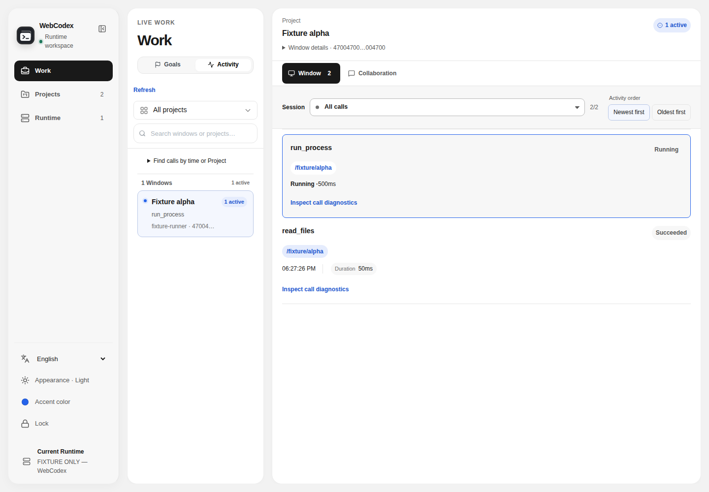

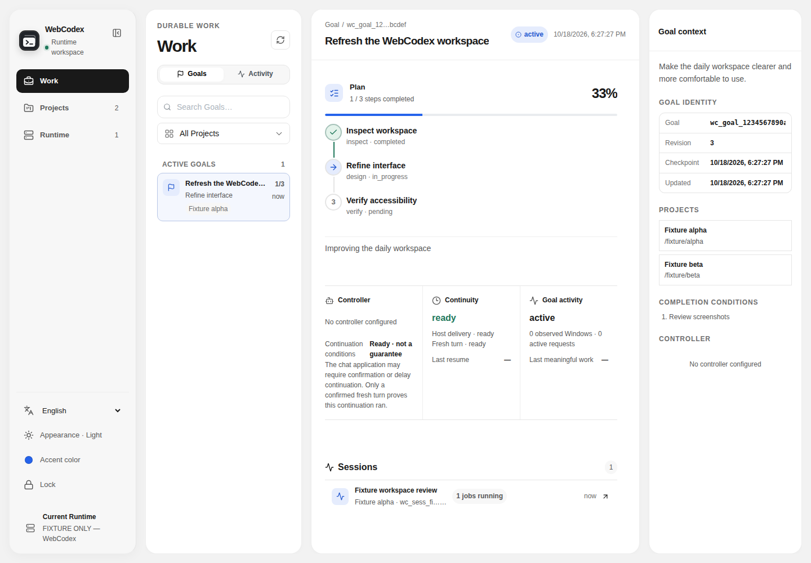

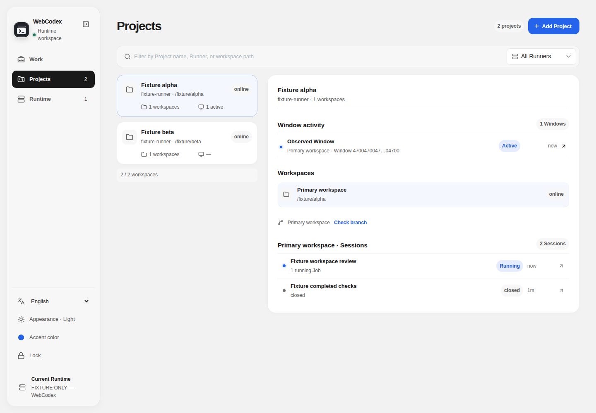

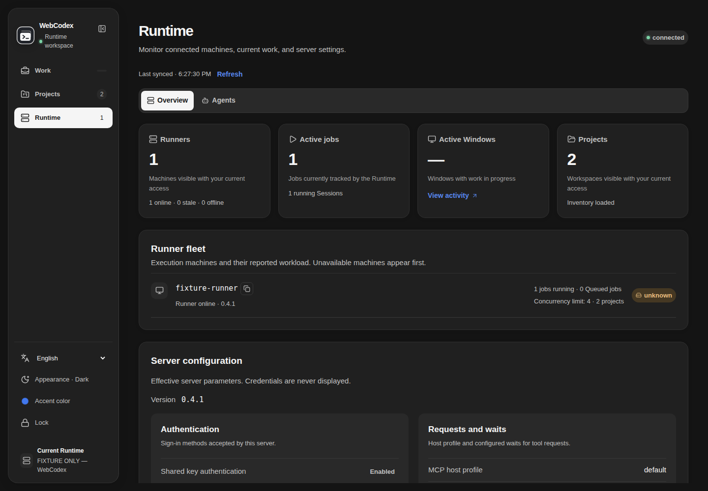

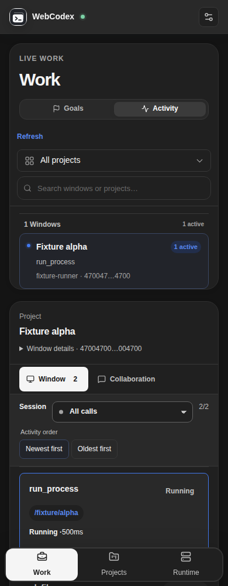

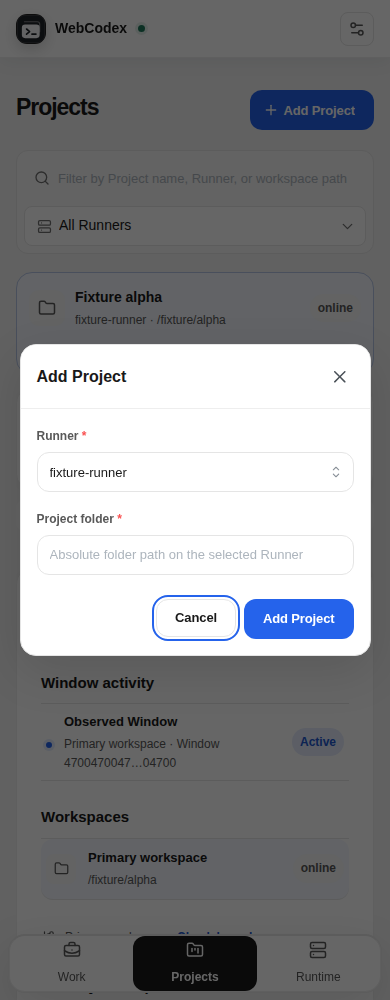

## Sidebar correction

The Runtime preference strip uses three compact Mantine controls: accent preset popover, cyclic appearance button and a language radio menu. The expanded rail shows one horizontal row; compact rails retain three centered targets. Lock is a separate action in the Runtime identity footer. Geometry, preference changes, keyboard focus and popup bounds are checked in English/Chinese with `node scripts/ui-smoke/sidebar-geometry.mjs`.

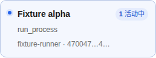

## Admin

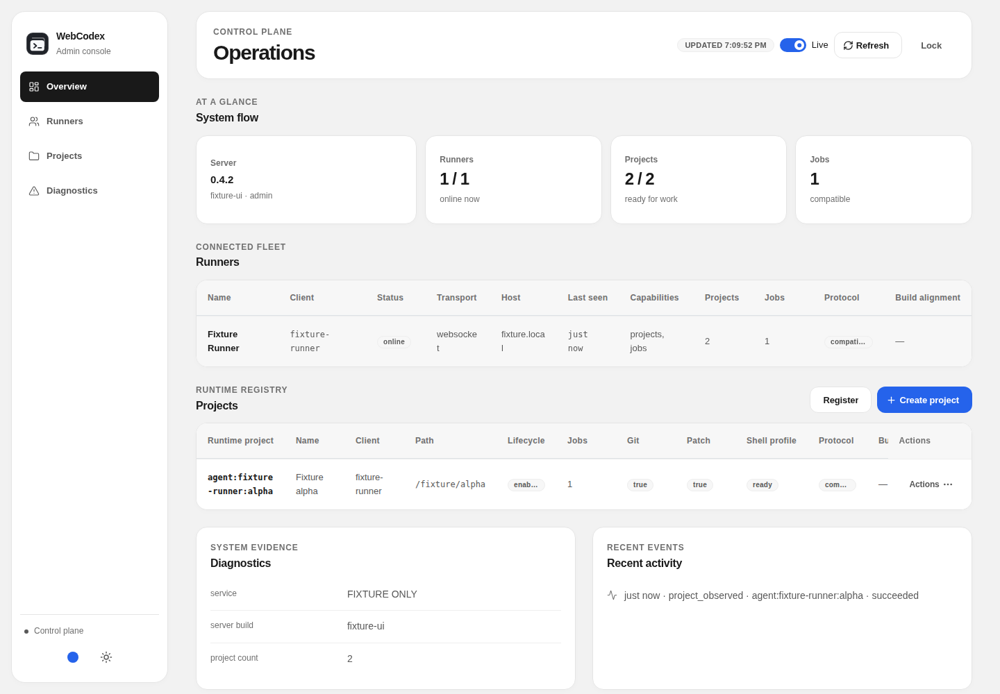

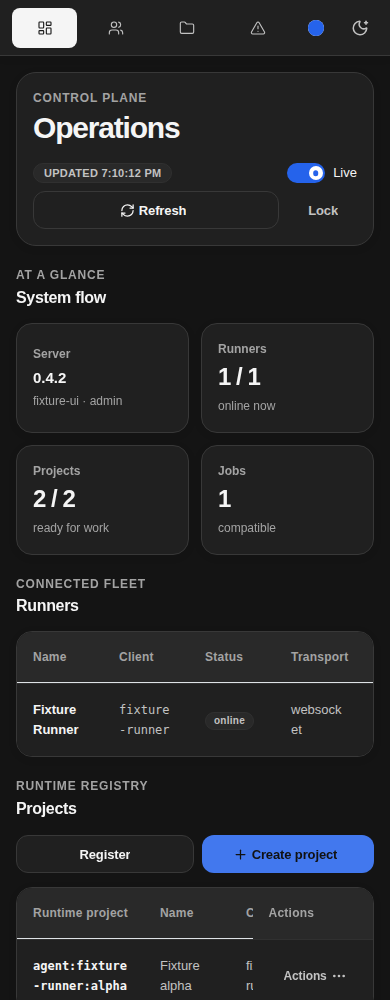

Admin preferences reuse Runtime's compact Mantine accent/appearance controls.
The two 36px buttons use a row on expanded/mobile navigation and a column on
compact rails. `node scripts/ui-smoke/admin-preferences.mjs` covers both themes
and all five widths at the gate and dashboard: 20 cases, including preset/custom
persistence, appearance cycling, focus trapping/restoration and popup bounds.

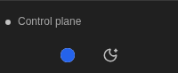

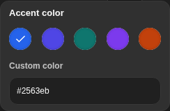

## Full-page consistency evidence

After building the frontend, run `node scripts/ui-smoke/web-page-consistency.mjs`
and `node scripts/ui-smoke/web-detail-consistency.mjs`. Reports, geometry and
screenshots are regenerated under ignored `artifacts/web-page-consistency/`.
Both use production bundles with isolated data at 1440/1280/1024/768/390/1920px in
light and dark themes. They check document overflow, shared content edges, selected
row geometry, absence of selection rails, dialog focus/restoration and readable
selected tabs. Ordinary wheel scrolling reaches the Admin form actions at 390×600.

| Web surface | Exercised browser evidence |
| --- | --- |
| Runtime access | Locked gate and advanced settings; theme/accent and language checks also run in the existing focused harnesses. |
| Work / Window | Activity, expanded identity, Session filter, collaboration, call diagnostics and retained payload. |
| Work / Goal | Selected plan, progress and context; denied/error detail states also have React regressions. |
| Session record | Workflow, collaboration, stale messages with retained draft, inspector Context/Evidence keyboard selection, Window chooser. Inspector intentionally collapses below 1350px. |
| Projects | Selected family/workspace, branch check, nested Session navigation and Add Project dialog. |
| Runtime | Overview, fleet/configuration, expanded diagnostics, Agent Inbox, Conversations, Profile, technical details and creation form. |
| Admin | Access, overview, Runners, Projects, Diagnostics/activity, Register/Create/Enable/Disable/Unregister dialogs. |
| Exceptional data | Representative Admin loading/first failure/empty/stale; Agent loading/first failure/empty; Project empty; Session stale. These are synthetic conditions, not an exhaustive catalogue of backend errors. |

The full-page matrix uses English Chromium. English/Chinese sidebars have a
separate geometry matrix. Screenshots are fixture evidence; real authenticated
reads are reported separately. No real project lifecycle operation or real model
workflow is exercised. Native Desktop, MCP embedded pages, other browsers and
another computer's actual LAN access remain outside this evidence.

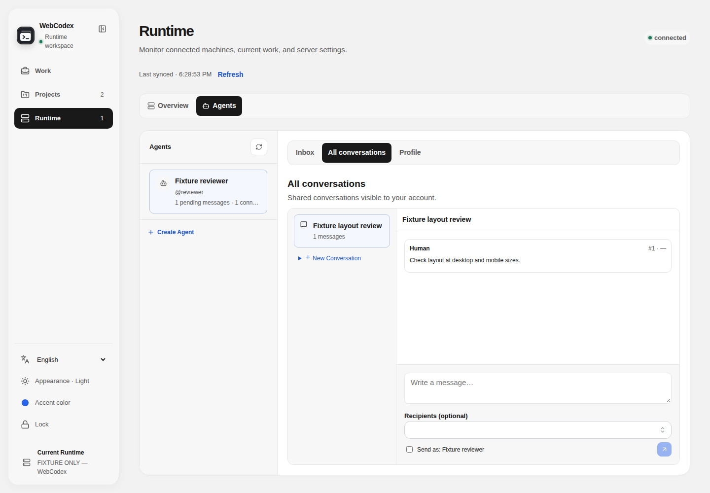

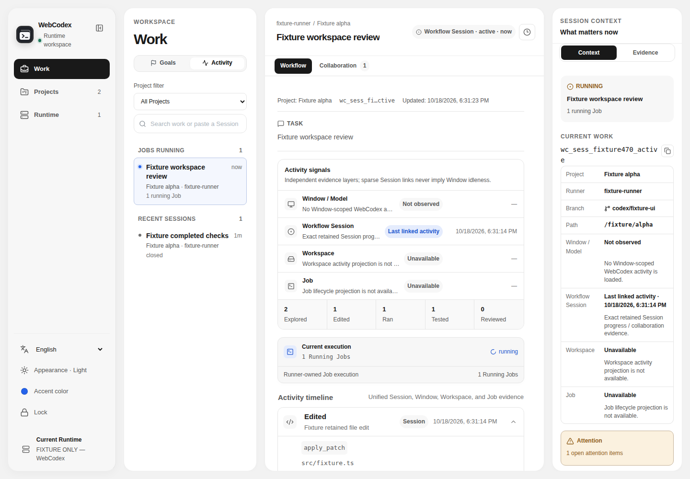

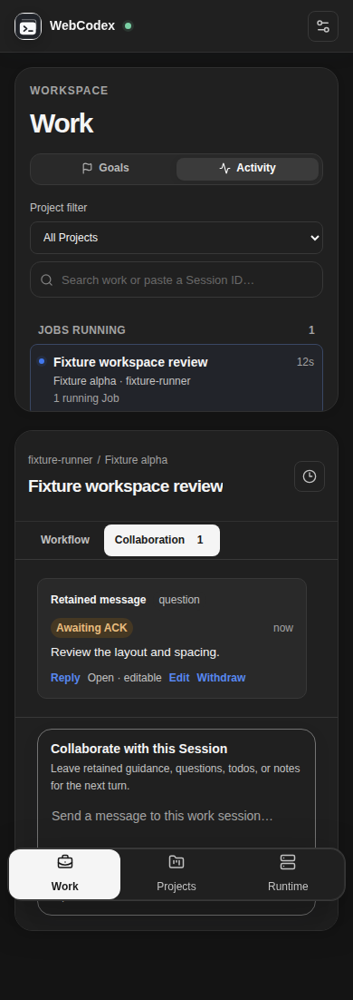

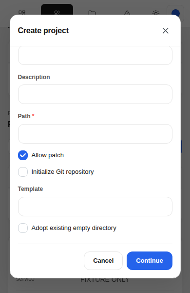

## Compact preference controls

Runtime uses Mantine `ActionIcon`, `Popover`, `ColorSwatch` and `Menu.RadioGroup`
for the preference strip, including the access gate and mobile settings entry.
The accent popover offers the five existing presets and a custom hex input.
Appearance cycles System → Light → Dark → System; the current state is shown by
its icon and tooltip. The language menu marks the current choice and uses the
library's keyboard and focus behavior. Preference storage and credential lock
continue through their existing owners. The sidebar check exercises preset and
custom colors, the cycle, language persistence, Escape/focus restoration, compact
layout and popup containment across five widths and both themes.

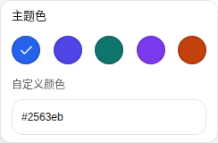

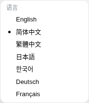

## Stable two-tab switches

`node scripts/ui-smoke/tab-alignment.mjs` uses production bundles with a measurable
17px classic scrollbar, so the Overview/Agent gutter regression is exercised in
headless Chromium. The matrix covers 2560/1920/1440/1280/1024/768/390px in both
themes, representative Chinese layouts and explicit rail collapse. It compares
heading and switch coordinates/track widths across repeated tall Overview,
denied Agent and available Agent states, plus Window/Collaboration transitions.
Metadata checks associate each semantic label with its full value, exercise exact
copy payloads and verify long canonical IDs wrap within their own field. Reports
and screenshots are under ignored `artifacts/web-page-consistency/tabs/verified/`.
The verified matrix passes 2,120 assertions across 20 cases/200 screenshots with
no renderer errors. The baseline reproduces an 8.5px heading shift; the fixed
switches measure 120px per track. Mobile Window comparisons first bring the
expanded switch above fixed navigation, then check both viewport and document
coordinates to distinguish ordinary scrolling from reflow. `--baseline` records
pre-fix defects separately and is not a passing regression.

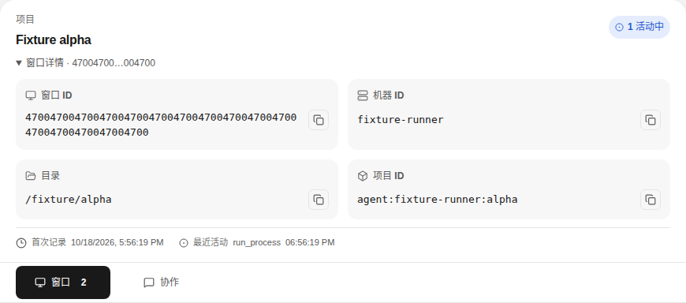
