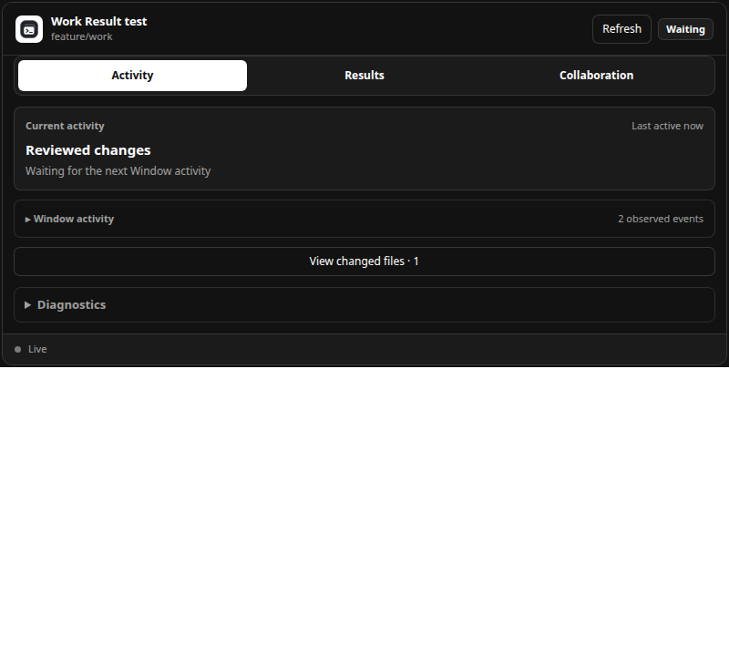
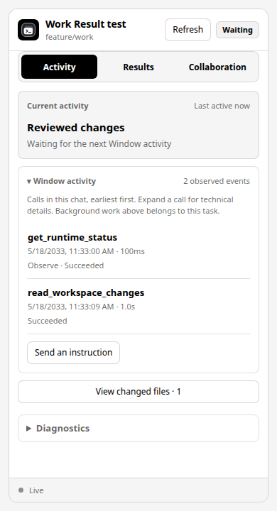
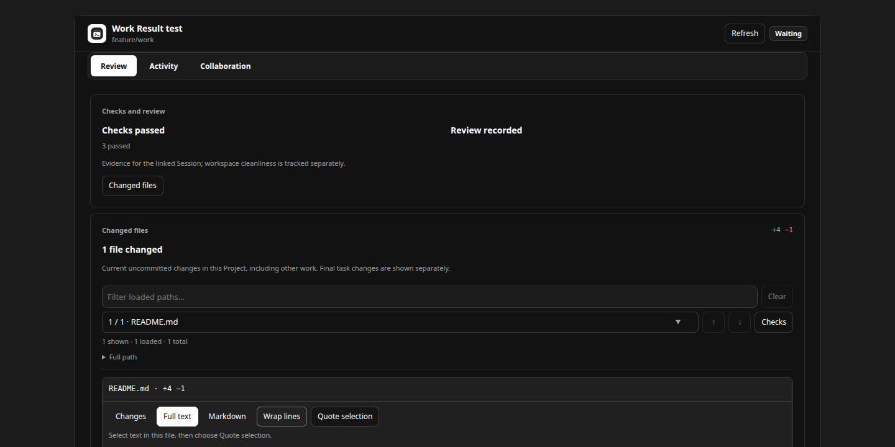

# Work Result card and review workspace

Work Result uses the same opaque, neutral surfaces, terminal brand, compact
controls and flowing selection as Workbench, Desktop and Runtime WebUI. Inline
cards and fullscreen review keep the same information hierarchy: identity and
refresh, Activity / Results / Collaboration navigation, current content, and
quiet diagnostics. Status colors communicate outcomes; they do not decorate the
navigation. Layout follows the Host's theme, display mode and font variables.

The main tabs and file-view selectors share the framework-neutral selection
controller described in [Flowing selection](../workbench-flowing-selection/README.md).
One persistent plate moves for 260 ms with at most 3% stretch and stationary
inverse-ink labels. Fast changes retarget the current visible position. Roving
tabindex follows selection without cancelling motion. File view navigation
excludes independent Wrap lines, Quote selection, load-more and retry actions.
Detached file views and disposed Apps destroy their observers and overlays.
A Host iframe height change preserves motion if the tabs have not reflowed;
actual responsive geometry changes still snap. Presentation layers disable
incidental CSS transitions so the shared controller owns movement.
Reduced motion snaps; forced colors retain platform selection and focus colors.

Panels use solid surfaces, consistent spacing and stable button geometry. Native
selectors retain their values, keyboard events and focus behavior; capable
browsers receive a styled, bounded native picker, while other Hosts retain the
platform picker. The card uses one document scroll, with horizontal scrolling
reserved for code or wide tables. Touch controls keep 44 px targets.

This is presentation work. Project/Session identity, pinned file snapshots,
collaboration drafts, explicit submission/retry, polling and Host message-source
checks remain authoritative. An invalid identity still fails closed with
`WR-IDENTITY-INVALID`; the unavailable footer no longer shows a green live dot.
No new tool call is introduced by the selection controller.

## Source and resource identities

- [App HTML](../../../src/mcp_work_result_app.html) contains the bridge and generated assets.
- [Card skin](../../../frontend/src/mcp-apps/work-result/work-result.css) owns presentation.
- [Shared builder](../../../frontend/scripts/build-selection-motion.mjs) embeds only first-party selection code, CSS and brand in both Apps, without an external request.
- Work Result is `ui://webcodex/work-result/v32`. Workbench is `ui://webcodex/workbench/v7` because its embedded controller also receives the roving-tabindex correction. Previous identities are retired; these are resource cache identities, not a product release.

## Browser evidence

The included captures use the shipped HTML under a disposable synthetic parent
bridge in Chromium. They contain fixture data, not a live project. They demonstrate
browser rendering and interactions, not acceptance in a native MCP Host, real
runtime, real model or deployed stable/test service.







[Actual tab motion recording](work-result-motion.webm) ·
[File-view motion recording](work-result-file-views.webm)

## Reproducing validation

```sh
npm --prefix frontend ci
npm --prefix scripts/ui-smoke ci
npm --prefix frontend run build
npm --prefix frontend run check:dist
npm --prefix frontend run typecheck
npm --prefix frontend run test:admin
npm --prefix frontend run test:runtime
node --test src/mcp_tests/*.test.mjs
node scripts/ui-smoke/mcp-workspaces.mjs
cargo test --locked -p webcodex --lib work_result --profile dogfood
cargo test --locked -p webcodex --lib app_registry --profile dogfood
```

The MCP browser matrix covers 320 / 390 / 800 / 1440 px, inline/fullscreen,
Host dark/light themes, normal/reduced motion, rapid switches, stationary labels,
keyboard focus, identity failure, file view selection, native pickers, forced
colors, Host sizing and teardown. Generated screenshots, recordings and JSON
reports stay under ignored `artifacts/mcp-workspaces/`.
